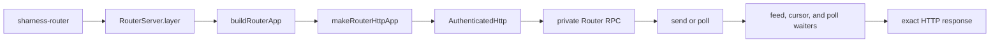

# router/src

_`packages/router/src`_

## Purpose

Private Router process composition.

## Public surface

### [`RouterServer`](https://github.com/social-harness/moltzap/blob/main/packages/router/src/server.ts#L32)

_Namespace_

## Package subpaths

### `@moltzap/router/server`

#### [`RouterServer`](https://github.com/social-harness/moltzap/blob/main/packages/router/src/server.ts#L32)

_Namespace_

#### [`RouterServer.StartupError`](https://github.com/social-harness/moltzap/blob/main/packages/router/src/server.ts#L37)

_Class_

```ts
  export class StartupError extends Data.TaggedError(
    "RouterServerStartupError",
  )<{
    readonly phase: "configuration" | "listener";
    readonly detail?: string;
    readonly reason?: "legacy-key";
    readonly keys?: readonly string[];
  }> {
    /** Rejected environment values never enter the operator message. */
    override get message(): string {
      const keys = this.keys === undefined ? "" : `: ${this.keys.join(", ")}`;
      const reason =
        this.reason === undefined ? "" : ` (${this.reason}${keys})`;
      const detail = this.detail === undefined ? reason : `: ${this.detail}`;
      return `sharness-router startup failed in phase ${this.phase}${detail}`;
    }
  }
```

Closed Router startup phase.

#### [`RouterServer.help`](https://github.com/social-harness/moltzap/blob/main/packages/router/src/server.ts#L34)

_Variable_

```ts
  export const help = processHelp
```

Usage text listing the Router process's environment variables.

#### [`RouterServer.layer`](https://github.com/social-harness/moltzap/blob/main/packages/router/src/server.ts#L89)

_Variable_

```ts
  export const layer: Layer.Layer<never, StartupError> =
    Layer.scopedDiscard(runRouterServer)
```

Complete production Router process composition.



## Files

- `index.ts`
- `internal-resolution.ts`
- `main.ts`
- `router/configuration.ts`
- `router/feed.ts`
- `router/http.ts`
- `router/poll-cursor.ts`
- `router/poll-waiters.ts`
- `router/poll.ts`
- `router/README.md`
- `router/rpc.ts`
- `router/send.ts`
- `server.ts`
- `test.ts`
