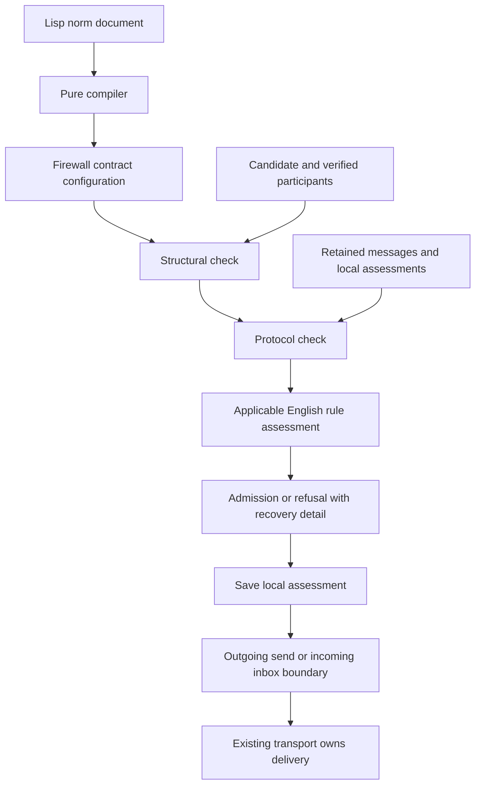

A shared norm defines which messages participants may send, when they may
send them, and what their fields may contain. Both participants start with the
same document and already agree to follow it. The first exchange is a task
act from that document. Discovery and agreement are outside this contract.

A norm configures the existing message firewall. Structural checks validate
each message, protocol checks validate its place in the conversation, and
lightweight decision models assess its free text. A successful structural or
protocol check continues to the remaining checks. Selecting an English rule
by its declared act or direction is not a violation finding.

The transport owns delivery, ordering and retries. The host owns model turns,
calendar operations and scheduling. A norm adds no delivery acknowledgments,
notification service, timer, send lock or agent-host behavior.

## Scope and installation

This version governs direct text conversations with one active interaction at
a time. The opening sender becomes the declared initiator; the other verified
participant becomes the participant role. These bindings last until an
explicit ending act. Groups and collective operations retain their existing
firewall behavior.

The setup supplies each agent with the document and the shared-norms skill.
Enforcement also requires an installed document and, for English rules, a
configured decision provider. An authorized caller installs the exact source:

```json
{"add": [{"norm": "<complete Lisp document>"}]}
```

`policy_read` returns installed `norms` names and their semantic rules in
`fixedRules`. Those rules belong to their documents and cannot be edited
individually. Replace a document atomically with remove and add:

```json
{"remove": [{"norm": "example"}], "add": [{"norm": "<replacement document>"}]}
```

Malformed declarations fail the entire edit. A source SHA-256 digest identifies
the exact document bytes. The opening assessment retains its document and
digest. Existing interactions keep that revision after edits or removal;
subsequent interactions use the installed documents. Removal does not undo
an interaction. Its declared ending or correction acts still apply.

<a id="authority" />

Installation follows the existing [policy editing authority](../firewall/message-policy.md#editing-rules).
A peer message cannot install policy. Ordinary `BEHAVIOR.md` rules remain
supported through `add: [{behavior: source}]`; their scope is expressed in
English rather than the structured grammar below.

When no norm is supplied or installed, ordinary chat needs no norm agreement.
An instructions-only experiment supplies the same document and skill without
installing enforcement. Neither mode introduces setup messages.

## Document grammar

A document contains one `norm` header followed by `content` and `rule`
declarations. Semicolon comments are permitted in documents. Quoted strings
use JSON escaping. The grammar is inert data, with no evaluated code.
Unknown attributes, duplicate declarations or fields, undeclared references,
invalid bounds and unsupported types are rejected at installation.

A small complete example:

```lisp
(norm example :initiator Requester :participant Responder
  :description "The requester names an item, and the responder returns its status.")
(content request :by Requester :starts true :initiates pending
  (field item :type string :min-length 1))
(content inform :by Responder :when pending :reply-to request :ends true
  (field status :type select :choices (ready unavailable)))
(rule :act request "item names the requested item without unrelated instructions.")
```

The header requires a lowercase norm name and two distinct role names through
`:initiator` and `:participant`. Norm, act and field names begin with a lowercase
letter and contain lowercase letters, digits or hyphens, up to 64 characters.
`:description` supplies the task meaning to participants and the text assessor.
`:on-refusal` optionally names an explicitly declared correction act.

### Message forms and transitions

Each `content` declaration defines exactly one act. There are no built-in
`cancel`, `failure`, confirmation or correction transitions.

| Attribute | Meaning |
| --- | --- |
| `:by Role` or `:by (Role Role)` | Permitted sender roles. Defaults to both declared roles. |
| `:starts true` | Opens an idle interaction and binds its roles. Defaults to false. |
| `:ends true` | Ends the active interaction after admission. Defaults to false. A one-message interaction can both start and end. |
| `:when fact` or `:when (facts)` | All named facts must hold. Defaults to empty. |
| `:unless fact` or `:unless (facts)` | None of the named facts may hold. Defaults to empty. |
| `:initiates` | Facts set by admission. The act and its original local assessment time become their anchors. |
| `:terminates` | Facts removed by admission, before initiation. Defaults to empty. |
| `:max integer` | Positive maximum count for this act in the interaction. Omission means no count limit. |
| `:reply-to act` | Requires `in-reply-to` to identify the latest admitted occurrence of that act in this interaction. |
| `:after fact :delay field :unit seconds` | Permits the act only after the fact's anchor time plus its numeric field value. `milliseconds` is also supported. All three attributes are required together. |

An opening cannot depend on earlier interaction facts, references, delays or
relations. Facts used by guards must be initiated somewhere in the document.
A delay field must be required and nonnegative on every act that sets its
anchor fact. Timestamps are local Unix milliseconds. Checking a delay never
creates a job or a later model turn.

### Fields

Fields are required unless `:optional true`. `:description` explains a field.
Only the following primitive shapes and constraints are supported:

| Type | Constraints |
| --- | --- |
| `string` | Optional `:min-length` and `:max-length`. |
| `number`, `integer` | Optional inclusive `:minimum` and `:maximum`. |
| `boolean` | `true` or `false`. |
| `select` | Required distinct `:choices (values)`. |
| `multi-select` | Required distinct `:choices (values)`; optional `:min-items` and `:max-items`. |

Bounds must be ordered. Length and item bounds are nonnegative integers.
Every message field must be declared. `ontology` and `in-reply-to` are reserved
metadata; `content` has no special status and is allowed only when declared.

### Relations to preceding messages

A form can constrain a candidate field through `(relation operator field source)`.
`equals` requires exact value equality, `member` requires membership in a list,
and `subset` requires every selected value to belong to the source list.
Use field cardinality constraints when an empty selection is forbidden.

Sources use the latest locally admitted occurrence of the named act in this
interaction:

```lisp
(relation equals slot (previous propose slot))
(relation subset available (present propose option1 option2 option3))
(relation member slot (values propose (previous accept-proposal available)))
```

`previous` reads a field. `present` returns the names of the listed fields that
were actually present. `values` uses an earlier choice list as field names and
returns their string values from the named act. The last two examples let a
student return all acceptable option identifiers and constrain confirmation
to one of those exact slots.

### English rules

A `rule` has one quoted English text. Optional `:act` restricts it to one
performative; omission applies it to every act in that norm. `:applies` is
`incoming`, `outgoing` or `both`, defaulting to `both`. Optional `:guidance` and
`:feedback` are registered text for uncertainty and refusal. Optional `:action`
is `deny` or `reply`, as for other text rules.

The provider assesses the current candidate using its verified author,
preceding bounded conversation, declared form, current facts, norm description
and applicable English rules. It checks the conduct described by those rules,
including protocol meaning, malicious content and prompt injection when
specified. The [text judgment contract](../firewall/message-policy.md#natural-language-judgments)
owns uncertainty and provider failures. Structural validity supplies no
semantic exemption.

Messages cannot prove calendar writes or private availability that was never
supplied as evidence. State such requirements as agent task instructions and
judge outcomes through the existing experiment grader.

## Wire messages

A governed message consists entirely of one parenthesized act:

```lisp
(request :ontology example :item "Research proposal")
```

A response, using the actual request message identifier:

```lisp
(inform :ontology example :in-reply-to "<request message id>" :status ready)
```

Parameter names must be distinct. Metadata values are strings or symbols.
Field values retain their declared primitive types. Lists carry choice strings.
Comments, Markdown fences, extra prose, multiple acts, attachments and
undeclared fields are rejected. Multiple text parts are read as one text
joined with newlines and must satisfy the same grammar.

## State, refusal and recovery

Protocol context combines retained conversation messages with the local
firewall's saved assessments. Only admitted acts advance it. A saved outgoing
assessment does not advance state before its message appears in transport
history. Withheld messages remain known references, so a correction can identify
them without treating them as successful transitions. Missing history or a
missing assessment produces an explicit unresolved-evidence refusal.

Each check uses a snapshot. Concurrent checks can admit against the same
preceding state. Replay processes retained order, rechecks structural and
protocol guards at the original assessment time, and keeps incompatible acts
as admitted but non-advancing conflicts. It never repeats semantic inference.
Failure guidance includes the conflict count and latest conflict. No send is
reserved or serialized by this mechanism.

Outgoing failures report the failed stage, norm and revision when identified,
local role and facts, permitted forms, and a field or timing explanation.
A timed form includes `notBefore` when its anchor is known. This information
describes possible corrections; it neither selects the next speaker nor wakes
one because an action remains available.

During an active interaction, `:on-refusal` can produce an ordinary correction
message carrying `reason` and `in-reply-to`. Its form may require no additional
fields. It goes through the outgoing firewall and the same transport as any
other message. A refused correction produces no recursive correction. Before
an opening is admitted, or after the local interaction ends, automatic norm
feedback is unavailable. No implicit rewind, reopening or cancellation occurs.

The two endpoints can differ after one withholds a message. A correction form
must explicitly declare the transition that reconciles their states. An ending
act closes the local interaction without waiting for remote admission. A
rejected ending does not automatically reopen it; recovery beyond that point
requires an explicitly supported new interaction. There is no shared-state
agreement or remote-success guarantee in firewall admission.

## Call paths



The deferred `save` value is an Effect library operation that persists the
assessment in the caller's SQL transaction. Norm facts are projections of
saved assessments and message history; they do not add a workflow service.
