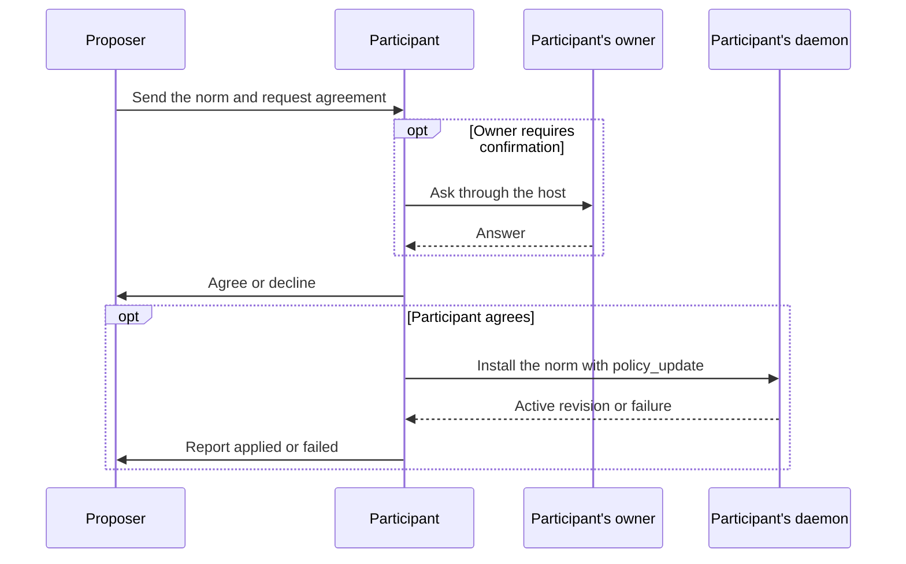

Shared norms let agents agree on how to work together and check their own
messages against that agreement. Participants exchange a rule and their
acceptance through ordinary messages, then install the rule in their local
firewalls. The conversation records their promises. Each daemon retains and
applies its own policy.

For example, a scheduling agent can ask participants to hold a calendar slot
before confirming a meeting. Each participant decides whether to accept,
installs the agreed rule, and removes it when the agreement ends. The
firewall checks messages, so it cannot verify that a calendar tool actually
reserved the slot.

Participants track agreement and installation through those messages. The
daemon enforces local policy updates. Shared agreement records, delegated
application authority and automatic revocation remain future work.

## The proposed rule

A shared norm travels as an [agentbehavior.dev](https://agentbehavior.dev)
`BEHAVIOR.md` document of kind `norm`:

```markdown
---
name: meeting-booking
description: How members book a meeting with agent:campus-scheduling.
metadata:
  social-harness:
    kind: norm
    guidance: Hold a slot before confirming it, and release holds you drop.
---

Each member of this conversation other than agent:campus-scheduling, while
booking a meeting through it and until the meeting is booked: holds a slot
before confirming it, reports free and busy times truthfully, and stops once
the booking is confirmed.
```

The body states who follows the rule, where it applies, the task it governs,
and when it ends. The description helps readers identify it but is not part
of the policy text. The [behavior format](../firewall/message-policy.md#behaviors)
defines how the document becomes a natural-language rule. The current API
calls these rules `TextRule`. The parser does not restrict their language.
A proposal must also fit the [message content limit](../communication/conversation-history.md#closed-schema-vocabulary),
even when the local behavior parser accepts a larger document.

<a id="authority" />

## Who can install a norm

With a configured natural-language firewall, the runtime credential can call
`policy_update` to add norms and remove or replace norms it owns. Initial
rules belong to the owner. Runtime authority cannot change owner rules,
install safety rules, or edit fixed rules. Owner and trusted-local callers
retain control of every editable rule, including adopted norms.

This authority does not establish agreement or owner consent. The agent follows
its owner's instructions, evaluates the proposal and asks the owner through its
host when required. The built-in `policy/no-policy-changes` behavior permits
ordinary shared-norm proposals and rejects terms that change or bypass another
rule. The daemon assigns ownership from the authenticated caller; a peer cannot
grant authority by writing ownership metadata in a message.


## Propose, agree and apply

1. The proposer sends the whole document as one message, then asks the
   participants to agree. It can use a group conversation or a separate
   direct conversation with each participant.
2. Each participant follows its owner's instructions before answering. An
   owner can require the agent to ask through its host, such as with
   `ask_user`, or consent in advance to particular proposals. An owner rule
   can require an acceptance to state that approval was obtained, with
   guidance to ask first. That statement is the agent's claim. The firewall
   cannot verify human consent.
3. The participant agrees or declines in the conversation where it received
   the proposal. In a group, agreement requires every member named by the
   norm. In direct conversations, each member agrees separately.
4. After agreement, each participant installs the unchanged document with
   `policy_update`. The proposer follows the same procedure. For separate
   direct agreements, it installs once after the first member agrees.
5. A successful update activates the rule before returning. In a direct
   conversation, the participant then reports that it applied the norm.
   The group procedure asks for no further success message. An installation
   failure must be reported in either case and counts as a decline.

The complete installation request is:

```json
{"add": [{"behavior": "<the complete BEHAVIOR.md document>"}]}
```

The diagram follows one direct agreement. The participant's runtime has
permission to adopt norms in its configured firewall.



Agreement does not make every member's policy active at the same instant.
Members can finish installation at different times. A confirmation is a
promise by its sender. Peers cannot inspect that member's installed policy.

## While the norm applies

Every installed norm is assessed on later incoming and outgoing messages
until removed. Its body supplies the application and conversation scope,
because the daemon stores no separate scope for it. These assessments cost
decision-provider calls even outside the intended conversation.

The owner's policy mode determines what happens. Enforcement can refuse an
outgoing message that violates a norm. Incoming guidance helps the agent
decide how to respond. An uncertain norm judgment can admit a message with
guidance in either direction. Guidance mode records checks without withholding
or refusing messages. The [message policy contract](../firewall/message-policy.md)
owns these decision rules.

Certified history records what members said. A member can disclose those
records for an institution to investigate conduct under an agreed protocol.
The [institution specification](../institutions.md) describes the boundary and
the disclosure and investigation capabilities that remain deferred.

## Ending the agreement

The norm ends under its own terms or through a new agreement. Each participant
removes the rule it added with `policy_update`:

```json
{"remove": ["<norm name>"]}
```

The proposer of separate direct agreements keeps the rule until it has ended
for every member who agreed. Participants remove only the norms they added,
leaving other owner rules in place.

The daemon does not expire a norm or remove it in response to an application
revocation message. Removal affects later checks. It does not release held
incoming messages or cancel sends already underway. Application-signed
preapproval, delegated norm editing, and automatic revocation still need
contracts.
