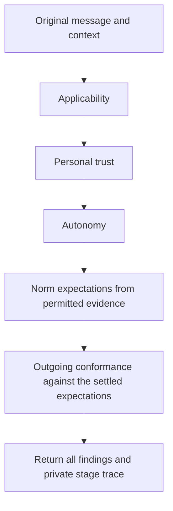
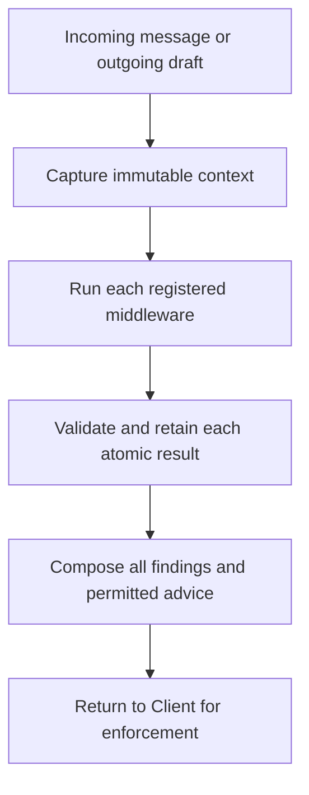

# client/firewall/evaluator

_`packages/client/src/firewall/evaluator`_

## Purpose

Personal firewall composition for code and English policies.

## Public surface

### [`makeEnglishPolicy`](./english.ts#L274)

_Variable_

```ts
export const makeEnglishPolicy = Effect.fn("makeEnglishPolicy")(
  function* (options: {
    readonly id: string;
    readonly rules: readonly EnglishRule[];
    readonly provider: DecisionProvider;
    readonly settings: unknown;
    readonly fixedRuleIds?: readonly string[];
  }): Effect.fn.Return<MessageMiddleware, CheckInputError> {
    const settings = yield* decodeFrozen(
      EnglishPolicySettings,
      options.settings,
    ).pipe(
      Effect.catchTag("ParseError", () =>
        Effect.fail(new CheckInputError({ reason: "settings" })),
      ),
    );
    const { id, rules } = yield* decodeFrozen(
      Schema.Struct({
        id: Schema.NonEmptyTrimmedString,
        rules: Schema.NonEmptyArray(EnglishRule),
      }),
      { id: options.id, rules: options.rules },
    ).pipe(
      Effect.catchTag("ParseError", () =>
        Effect.fail(new CheckInputError({ reason: "registration" })),
      ),
    );
    if (new Set(rules.map((rule) => rule.id)).size !== rules.length) {
      return yield* new CheckInputError({ reason: "registration" });
    }
    const descriptions = yield* ruleDescriptions(rules);
    const revision = englishRevision(rules, settings);
    const provider = Object.freeze({
      decide: options.provider.decide.bind(options.provider),
    });
    return Object.freeze({
      id,
      revision,
      rules: descriptions,
      provenance: englishProvenance(
        rules,
        settings,
        options.provider,
        options.fixedRuleIds,
      ),
      check: (input: MiddlewareInput) =>
        checkEnglish(input, { rules, revision }, provider, settings),
    });
  },
)
```

Freezes English documents and provider settings for repeated checks in either
direction. Question semantics and documents determine the recorded revision.
`fixedRuleIds` names the rules composition fixed against owner edits; it is
recorded in the provenance only, so a retained check keeps which of its
rules were fixed, and never changes checking.



### [`makeFirewall`](./index.ts#L71)

_Variable_

```ts
export const makeFirewall = Effect.fn("makeFirewall")(function* (options: {
  readonly incoming: readonly MessageMiddleware[];
  readonly outgoing: readonly MessageMiddleware[];
  readonly settings: unknown;
}): Effect.fn.Return<Firewall, CheckInputError> {
  const settings = yield* decodeFrozen(FirewallSettings, options.settings).pipe(
    Effect.catchTag("ParseError", () =>
      Effect.fail(new CheckInputError({ reason: "settings" })),
    ),
  );
  const incoming = yield* makeChain(options.incoming, settings);
  const outgoing = yield* makeChain(options.outgoing, settings);
  return Object.freeze({
    checkIncoming: (message: Message, context: MessageContext) =>
      incoming({ direction: "incoming", message }, context).pipe(
        Effect.flatMap((result) =>
          result.judgment === "revise"
            ? Effect.fail(new CheckInputError({ reason: "message" }))
            : Effect.succeed({ ...result, judgment: result.judgment }),
        ),
      ),
    checkOutgoing: (message: Message, context: MessageContext) =>
      outgoing({ direction: "outgoing", message }, context),
  });
})
```

Runs every installed check in order within the budget. Refusals accumulate;
only Client can apply the result to an exact candidate with fresh evidence.
Cancellation propagates, so an interrupted check never returns permission.



### [`makeJevDecisionProvider`](./jev.ts#L182)

_Function_

```ts
export function makeJevDecisionProvider(options: {
  readonly apiKey: Redacted.Redacted;
  readonly model: string;
}): DecisionProvider
```

Uses the fixed TypeSafe origin and an explicitly pinned model. No retry,
environment lookup or credential serialization occurs here. The evaluator
owns timeouts; the Effect is interruptible through response-body consumption.

## Files

- `english.ts`
- `index.ts`
- `jev.ts`
