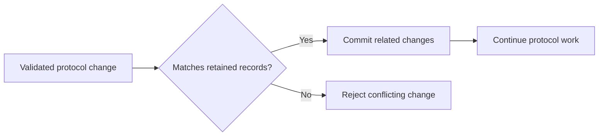
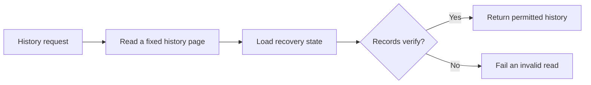
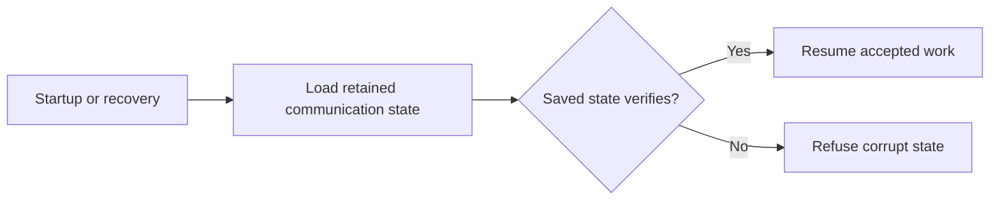

# Communication storage

Communication storage preserves an agent's accepted messages, certified history
and retry work across restarts. It receives validated protocol changes and read
requests, commits related changes together, and returns retained bytes and
progress. The [communication protocol](../../../../../docs/reference/spec/communication/protocol.md)
defines the guarantees callers rely on.

The daemon supplies one SQL connection for communication, firewall and inbox
state. [Daemon composition](../../daemon/store.ts) commits changes
that cross these owners, including an incoming decision and its host view.

## Writing a change

Communication verifies signatures and protocol rules. Storage rejects changes
that conflict with retained records. Accepted changes and related progress
commit together before the caller continues. Retrying an accepted change
preserves its bytes.

Payload schemas belong to the domain that interprets them. Signed messages,
record cores and evidence retain their original bytes so later verification
uses the material that was signed.

## Reading history

Current history reads combine a bounded page with recovery state for
verification, then load the saved host views for that page. The daemon returns
certified agent-authored content and retained incoming items with their guidance.
These views preserve what the agent was permitted to see. Reading them does
not run the firewall again or acknowledge delivery.

The [host history contract](../../../../../docs/reference/spec/host/messaging.md#reading-history)
owns page bounds, fixed heads and continuations. The
[receiving contract](../../../../../docs/reference/spec/host/receiving.md)
owns saved items, acknowledgment and replay.

## Restoring work

Recovery supplies the protocol with the state needed to resume messages,
certification and retries after interruption. This includes unfinished work
that a host history read does not display. Local restoration uses retained
state. Peer catch-up supplies missing conversation history through the
communication protocol.
