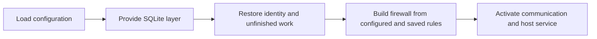
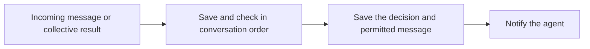
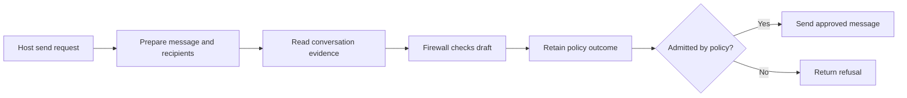

# Agent daemon

The daemon connects one agent's communication, firewall and durable inbox.
It prepares checks, applies their judgments and offers the resulting items to
the host after they are saved.

This draft describes the daemon boundary under review.

## Responsibilities

| Component | Owns |
| --- | --- |
| Communication | Verified records, accepted sends and collective operation state |
| Firewall | Message checks, rule changes and required approval |
| Daemon | Evidence preparation, checking order and application of judgments |
| Store | Durable state, retained visibility, history reads and atomic publication |
| Host | Model execution, tools and acknowledgment after accepting delivery |

The daemon provides one SQLite layer for its lifetime. Communication, firewall
and delivery operations share its `SqlClient` through the Effect environment.

## Startup

## Incoming message

Later checks use the conversation history available to the agent.

## Outgoing message

## Persistence with Effect

The SQLite layer opens the agent's database and closes it when the daemon
stops. Startup prepares the schema and restores unfinished work before serving
requests. The same layer instance supplies `SqlClient` to every component.

Database operations stay with the code that uses them. They require
`SqlClient` in their Effect environment instead of receiving a combined
`DaemonStore` object. The daemon supplies that dependency at startup.

Use `sql.withTransaction` when an operation changes records that must stay
consistent. Saving an incoming decision and the message the agent may read is
one such operation. Reads return the saved view, without another firewall check.

Effect Schema and `SqlSchema` decode database rows. Table definitions and
schema generation remain a separate choice from connection ownership and
transactions.
