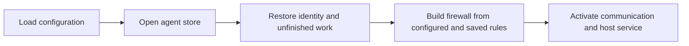
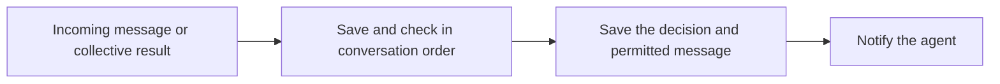
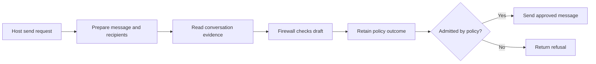

# Agent daemon

The daemon connects one agent's communication, firewall and durable inbox.
It prepares checks, applies their judgments and offers the resulting items to
the host after they are saved.

This draft describes the daemon boundary under review.

## Responsibilities

| Component | Owns |
| --- | --- |
| Communication | Verified records, accepted sends and collective operation state |
| Firewall | Message checks, rule changes and required approval |
| Daemon | Evidence preparation, checking order and application of judgments |
| Store | Durable state, retained visibility, history reads and atomic publication |
| Host | Model execution, tools and acknowledgment after accepting delivery |

`daemon/store.ts` opens one database and supplies the operations those owners
need. Incoming work, evidence windows and publication belong to this store.
The firewall receives only rule and check persistence operations.

## Startup

## Incoming message

Later checks use the conversation history available to the agent.

## Outgoing message

