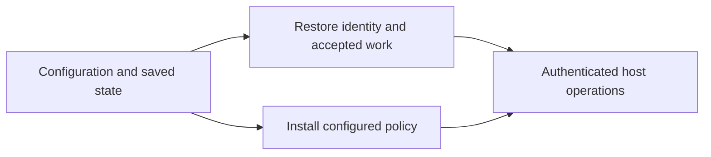
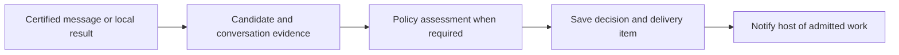
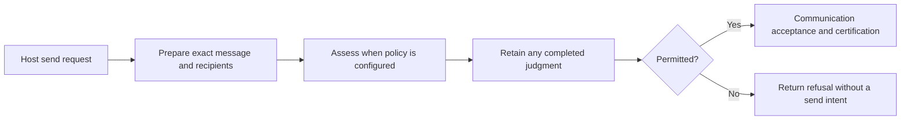
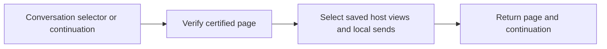

# Agent daemon

The daemon connects one agent's host to certified communication and local
message policy. It saves incoming items and delivery progress across restarts. The [daemon contract](../../../../docs/reference/spec/daemon/daemon.md)
defines the externally observable behavior.

## Startup

Startup establishes one agent's endpoint from configured credentials, network
settings and saved state. It restores the identity and accepted work, installs
any configured firewall, and serves authenticated host operations. Outstanding
communication can continue recovering after the host connects.

The daemon supplies one SQLite connection for its lifetime. Communication,
firewall and delivery operations use their own state through that connection.
Closing the daemon's scope closes the database. Incompatible saved state stops
startup before host requests are served.

## Incoming messages

Incoming work is a certified peer message or the result of a local operation.
Communication owns verification and certification. The daemon combines the
candidate's text and verified identities with earlier conversation evidence for
policy assessment. That evidence identifies what the agent has seen and what
remains private.

An admitted item enters the inbox with any guidance. Withheld content stays
private. Saving the decision, host view and answer visibility is one change. Interrupted checks
leave incoming work pending. Each conversation advances independently.

A result may contain withheld peer answers while its remaining outcomes reach
the host. Daemon-generated failures bypass policy assessment.
The [message-policy contract](../../../../docs/reference/spec/firewall/message-policy.md#collective-operations)
owns which texts require assessment.

## Outgoing messages

The host supplies a destination and message, question or answer.
Communication prepares fixed content, recipients and identities. When a
firewall is configured, the daemon supplies that candidate and its evidence
for assessment before asking communication to accept it.

The host receives a send outcome with any permitted guidance or a refusal. A
judgment permits the attempt. Communication still decides whether it can accept
and certify that message. Recovery continues accepted work with its saved
identity. The [send outcomes](../../../../docs/reference/spec/host/messaging.md#failed-or-uncertain-sends)
explain what the host should do when completion is uncertain.

## Reading history

The host selects a conversation or resumes a page. Communication supplies
certified records and their verification material. The daemon returns saved received items and locally accepted sends.

The first read fixes the last certified record included in its pages. Received
entries reuse the saved item and guidance even after acknowledgment. Reading history
runs no new policy check and neither acknowledges a delivery nor authorizes a
reply. Private assessment evidence stays outside the response.
