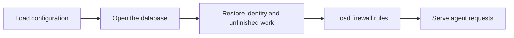
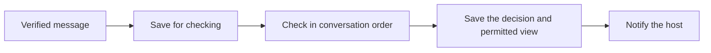
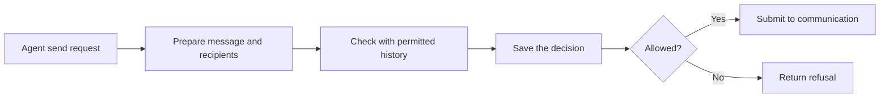

# Agent daemon

The daemon connects one agent's communication, firewall and durable inbox.
It checks new messages and saves the permitted view before notifying the host.

## Startup

The daemon provides one SQLite `SqlClient` layer for its lifetime. Communication,
firewall and delivery operations share that connection. Closing the daemon's
scope closes the database.

## Incoming messages

Each conversation advances independently. Later checks use the history the
agent was permitted to see. History reads return that saved view.

The decision and permitted view commit together. Interrupted checks leave
messages pending for recovery. Daemon-generated results enter the inbox directly.

## Outgoing messages

Communication owns acceptance and certification. A firewall approval allows
submission. It does not guarantee that peers accept the message.

## Durable state

Domain operations decode saved values with their owning Effect Schemas and use
SQL transactions for related writes. Signed records retain their original bytes.
Delivery acknowledgment changes status without deleting the saved message.

The database layer rejects incompatible state before serving requests. Recovery
restores accepted work before new requests begin.
