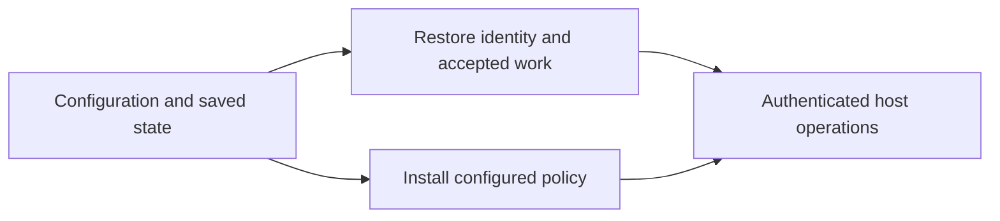
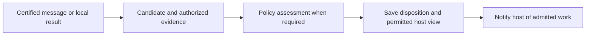
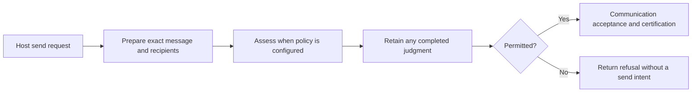

# Agent daemon

The daemon connects one agent's host to certified communication and local
message policy. Its output is a durable view the host may read, with delivery
progress that survives restart. The [daemon contract](../../../../docs/reference/spec/daemon/daemon.md)
defines the externally observable behavior.

## Startup

Startup establishes one agent's endpoint from configured credentials, network
settings and saved state. It restores the identity and accepted work, installs
any configured firewall, and serves authenticated host operations. Outstanding
communication can continue recovering after the host connects.

The daemon supplies one SQLite connection for its lifetime. Communication,
firewall and delivery operations use their own state through that connection.
Closing the daemon's scope closes the database. Incompatible saved state stops
startup before host requests are served.

## Incoming messages

The input is a certified peer message or a result produced by a local operation.
Communication owns verification and certification. The daemon combines the
candidate's text and verified identities with authorized preceding evidence for
policy assessment. Evidence distinguishes content the agent has seen from
private assessor material.

The output is a saved item with any guidance, or a withheld disposition. Saving the
decision, host view and answer visibility is one change. Interrupted checks
leave incoming work pending. Each conversation advances independently.

A result may contain withheld peer answers while its remaining outcomes reach
the host. Endpoint-authored operation failures need no inferred peer judgment.
The [message-policy contract](../../../../docs/reference/spec/firewall/message-policy.md#collective-operations)
owns which texts require assessment.

## Outgoing messages

The input is the host's explicit destination and text, question or answer.
Communication prepares fixed content, recipients and identities. When a
firewall is configured, the daemon supplies that candidate and its evidence
for assessment before asking communication to accept it.

The output is a send outcome with any permitted guidance or a refusal. A
judgment permits the attempt; communication still owns request liveness,
acceptance and certification. Recovery continues accepted work with its saved
identity. The [send outcomes](../../../../docs/reference/spec/host/messaging.md#failed-or-uncertain-sends)
explain what the host should do when completion is uncertain.

## Reading history

The input is a conversation selector or a continuation. Communication supplies
certified records and their verification material. The daemon uses retained
local acceptance and disclosure state to select what the host may read.

The output is a page under the read's fixed certified head. Received entries
reuse the saved item and guidance even after acknowledgment. Reading history
runs no new policy check and neither acknowledges a delivery nor authorizes a
reply. Private assessment evidence stays outside the response.

## Proposed implementation simplification

These changes are for discussion and are not implemented: pass each decoded
queued item through its assessment, share the decoder for retained items and
guidance across reads, and have history reads fetch only their page's verification and
local acceptance material instead of complete endpoint recovery state.

The proposal keeps certified records, assessment evidence and saved host items
distinct. The open design choices are where decoded preparations become
immutable and which supporting records one history page must capture together.
Exact API changes belong in the accompanying proposal before implementation.
