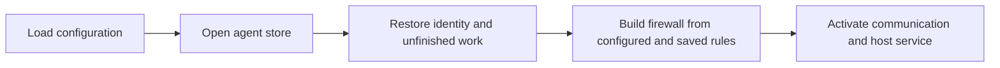
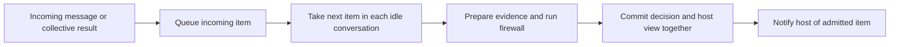
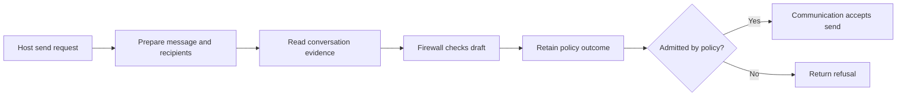

# Agent daemon

The daemon connects one agent's communication, firewall and durable inbox.
It prepares checks, applies their judgments and offers the resulting items to
the host after they are saved.

This is an interface draft for review. It proposes the store and orchestration
boundary before further runtime changes.

## Responsibilities

| Component | Owns |
| --- | --- |
| Communication | Verified records, accepted sends and collective operation state |
| Firewall | Message checks, rule changes and required approval |
| Daemon | Evidence preparation, checking order and application of judgments |
| Store | Durable state, retained visibility, history reads and atomic publication |
| Host | Model execution, tools and acknowledgment after accepting delivery |

`daemon/store.ts` opens one database and supplies the operations those owners
need. Incoming work, evidence windows and publication belong to this store.
The firewall receives only rule and check persistence operations.

## Startup



## Incoming message



A collective result commits its question and answer decisions together. The
store retains the text the host may read and which answers it showed. Future
checks use that retained visibility. A withheld item finishes its check so
the next item in its conversation can proceed.

## Outgoing message



Communication still checks that a named request is open when accepting an
answer. A passing firewall judgment does not establish that acceptance.

## Proposed store exports

`openDaemonStore` is the constructor. `DaemonStore` combines existing
communication and inbox persistence with the firewall's narrow persistence
interface and the operations below. SQL helpers and table initializers remain
implementation details.

```typescript
/**
 * Preserves one agent's communication, policy, checks and retained host view.
 * Related publication changes either commit together or leave state unchanged.
 */
export interface DaemonStore
  extends EndpointStore, InboxStore, FirewallPersistence {
  /** Returns decision summaries without message content, private evidence or provider traces. */
  readDecisions(
    query: DecisionsQuery,
  ): Effect.Effect<DecisionHistory, EndpointStoreError>;

  /** Returns up to 100 saved rule changes, newest first, since an inclusive Unix-millisecond time. */
  readRuleChanges(
    since?: number,
  ): Effect.Effect<readonly StoredRuleChange[], EndpointStoreError>;

  /** Queues an immutable item once under its delivery identity and conversation. */
  queueIncoming(item: QueuedItem): Effect.Effect<void, EndpointStoreError>;

  /** Returns the earliest unchecked item in each conversation, in queue order. */
  nextItemsToCheck(): Effect.Effect<readonly QueuedItem[], EndpointStoreError>;

  /** Visits unfinished items after a saved sequence during restart recovery. */
  readPendingItems(
    after: number,
  ): Effect.Effect<readonly QueuedItem[], EndpointStoreError>;

  /** Reads bounded conversation history and its retained visibility before an item. */
  readEvidence(range: EvidenceRange): Effect.Effect<Evidence, EndpointStoreError>;

  /** Captures all result windows in one read, preserving the supplied range order. */
  readEvidenceBatch(
    ranges: readonly EvidenceRange[],
  ): Effect.Effect<readonly Evidence[], EndpointStoreError>;

  /** Returns whether the host saw a request and any decision that withheld it. */
  readRequestVisibility(
    recordHash: RecordHash,
  ): Effect.Effect<RequestVisibility | undefined, EndpointStoreError>;

  /**
   * Completes the check and settles its queued item in one transaction.
   * Admitted text and guidance enter the inbox together. Withheld text stays private.
   */
  publishIncoming(
    item: ItemProjection,
    completion: FirewallCompletion,
  ): Effect.Effect<"admitted" | "withheld", EndpointStoreError>;

  /**
   * Commits all result checks, answer visibility and the retained host item together.
   * Endpoint-authored failures retain an audit without model assessment.
   */
  publishResult(
    result: LocalResultPublication,
  ): Effect.Effect<void, EndpointStoreError>;

  /** Retires an expired unchecked request while preserving its communication history. */
  retireIncoming(token: DeliveryToken): Effect.Effect<void, EndpointStoreError>;

  /** Finishes the policy assessment for the exact outgoing candidate it began. */
  finishOutgoingCheck(
    completion: FirewallCompletion,
    candidate: Uint8Array,
  ): Effect.Effect<"admitted" | "withheld", EndpointStoreError>;
}

/**
 * Opens the agent's state for the caller's scope and restores unfinished work.
 * Refuses incompatible state before modification. Closing the scope closes the database.
 */
export declare function openDaemonStore(
  stateDirectory: string,
  options: { readonly liveWireVersions: readonly string[] },
): Effect.Effect<DaemonStore, EndpointStoreError | OutboxTooOldError, Scope.Scope>;
```

`QueuedItem` carries its delivery identity, conversation and retained bytes.
`EvidenceRange` names the conversation, stopping point and history limit.
`Evidence` contains preceding records, their visibility and any missing evidence.
`ItemProjection` is the text and guidance stored for host delivery.
`LocalResultPublication` groups that view with every check completion and
answer visibility change that must commit with it.

The existing communication and host inbox operations remain part of their
respective interfaces. The declarations above define the policy and delivery
operations being separated in this pass.

## Decision to resolve together

The current implementation records outgoing `admitted` as a policy approval
before communication acceptance. The current specification promises that a
later request expiry or prior answer changes that disposition to `withheld`.
Those meanings disagree.

This draft exposes the distinction in the outgoing flow. We need to choose
whether the retained field means policy admission or actual send acceptance
before finalizing `finishOutgoingCheck` and the answer-selection guarantee.
