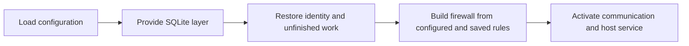
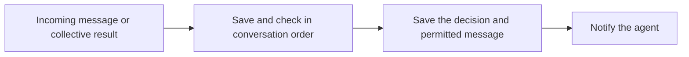
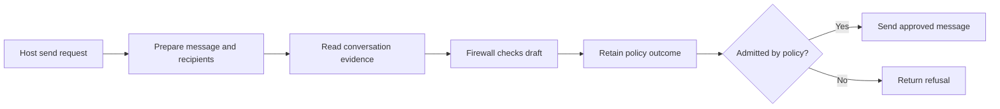

# Agent daemon

The daemon connects one agent's communication, firewall and durable inbox.
It prepares checks, applies their judgments and offers the resulting items to
the host after they are saved.

This draft describes the daemon boundary under review.

## Responsibilities

| Component | Owns |
| --- | --- |
| Communication | Verified records, accepted sends and collective operation state |
| Firewall | Message checks, rule changes and required approval |
| Daemon | Evidence preparation, checking order and application of judgments |
| Store | Durable state, retained visibility, history reads and atomic publication |
| Host | Model execution, tools and acknowledgment after accepting delivery |

The daemon provides one SQLite layer for its lifetime. Communication, firewall
and delivery operations share its `SqlClient` through the Effect environment.

## Startup



## Incoming message



Later checks use the conversation history available to the agent.

## Outgoing message



## Persistence with Effect

The daemon provides one SQLite layer for its lifetime. Communication, policy
and delivery operations obtain the same `SqlClient` from the Effect
environment. The layer opens the database, prepares its schema and closes it
when the daemon stops. Recovery finishes before the daemon serves requests.

Persist each record using its owning Effect Schema. Keep signed records and
messages in their original byte representation. Readers select saved objects
by identity, conversation or pending status. Acknowledging delivery changes
its status without removing the saved message.

### Proposed store interface

The store exposes Effect SQL's existing `SqlClient` service. The proposed
export from `daemon/store.ts` builds the layer:

```typescript
/**
 * Opens one agent's database and provides it for the daemon's lifetime.
 * Maps initialization failures to startup errors. Closing the layer closes the database.
 */
export declare function layer(
  options: {
    readonly stateDirectory: string;
    readonly liveWireVersions: readonly string[];
  },
): Layer.Layer<
  SqlClient.SqlClient,
  EndpointStoreError | OutboxTooOldError
>;
```

`SqlClient` comes from `@effect/sql/SqlClient`. Database operations return
schema-decoded values and declare that service in their Effect environment.
Use `SqlSchema` for query results and `sql.withTransaction` for related writes.
A saved check decision and the message it permits share one transaction.
History reads use the saved decisions.

Record grouping, indexes, schema generation and the SQLite driver remain
to be selected before implementation.
