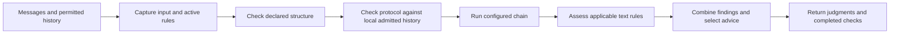
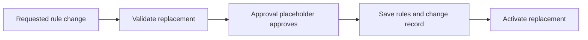

# Message firewall

The firewall checks incoming messages and outgoing drafts against configured
rules. It returns a judgment and advice, and manages changes to editable rules.

## Checking messages

One call keeps the same policy for every message, including the question and
answers in a collective result. Structural success continues to protocol and
semantic assessment. A configured contract's semantic rules remain mandatory
after a chain allow. Advice uses registered instructions.

The daemon supplies verified participants and permitted conversation history.
It saves completed checks. Incoming messages remain pending if checking is
interrupted. Daemon-generated results have no firewall check.

## Changing rules

Approval currently always succeeds. The placeholder can later use host
elicitation. Fixed rules come from configuration and cannot be edited.

A failed save leaves the active rules unchanged. In-flight checks keep the
policy they captured.

## Using the firewall

`Firewall.layer` loads saved editable rules, seeding them from configuration on
the first startup. It obtains the daemon's shared `SqlClient` and identity
through Effect.

The test-only entry exports `checkMessage` for evaluating supplied rules and
evidence with an injected provider. It performs no storage or configuration reads.

The firewall receives compiled contracts describing message forms, transitions
and text rules. It joins supplied conversation history with exact local
assessment records to check those contracts. The
[message-policy specification](../../../../docs/reference/spec/firewall/message-policy.md)
defines its inputs, decisions and evidence requirements.
