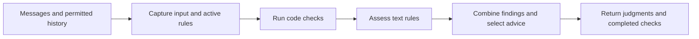
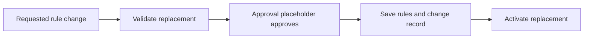

# Message firewall

The firewall checks incoming messages and outgoing drafts against configured
rules. It returns a judgment and advice, and manages changes to editable rules.

## Checking messages

One call keeps the same policy for every message, including the question and
answers in a collective result. Advice selects registered instructions and
references the host may see.

The daemon supplies verified participants and permitted conversation history.
It saves completed checks. Incoming messages remain pending if checking is
interrupted. Daemon-generated operation failures have no firewall check.

## Changing rules

Approval currently always succeeds. The placeholder can later use host
elicitation. Fixed rules come from configuration and cannot be edited.

A failed save leaves the active rules unchanged. In-flight checks keep the
policy they captured.

## Using the firewall

`makeFirewall` loads saved editable rules, seeding them from configuration on the
first startup. It obtains the daemon's shared `SqlClient` through Effect.
Its `readPolicy`, `updatePolicy` and `check` operations capture their dependencies
so callers do not pass a store.

The test-only entry exports `checkMessage` for evaluating supplied rules and
evidence with an injected provider. It performs no storage or configuration reads.
