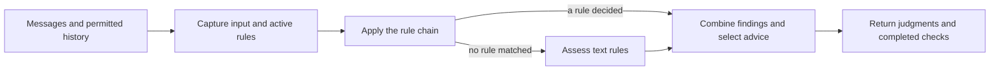
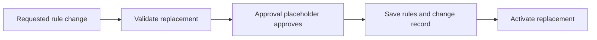

# Message firewall

The firewall checks incoming messages and outgoing drafts against a rule chain
and text rules. It returns a judgment and advice, and manages changes to
editable rules.

## Checking messages

The rule chain runs first: each rule names a matcher that another module
registers, such as the norms checks, and the first rule whose matcher matches
decides the message. A message no chain rule decides goes on to the text rules.
One call keeps the same policy for every message, including the question and
answers in a collective result. Advice selects registered instructions and
references the host may see.

The daemon supplies verified participants and permitted conversation history.
It saves completed checks. Incoming messages remain pending if checking is
interrupted. Daemon-generated results have no firewall check.

## Changing rules

Approval currently always succeeds. The placeholder can later use host
elicitation. Fixed rules come from configuration and cannot be edited.

A failed save leaves the active rules unchanged. In-flight checks keep the
policy they captured.

## Using the firewall

`Firewall.layer` loads saved editable rules, seeding them from configuration on
the first startup. It obtains the daemon's shared `SqlClient` and identity
through Effect.

The test-only entry exports `checkMessage` for evaluating supplied rules and
evidence with an injected provider. It performs no storage or configuration reads.
