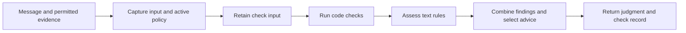
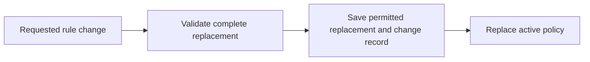

# Message firewall

The firewall checks incoming messages and outgoing drafts against configured
rules. It returns a judgment and registered advice, and manages authorized
changes to editable rules. Policy determines when human approval is required.

This is an interface draft for review. The declarations below propose the next
boundary. Runtime code remains unchanged by this draft.

## Responsibilities

| Input | Output |
| --- | --- |
| Message, verified participants and permitted history | A judgment and advice restricted to visible evidence |
| Initial rules and previously saved editable rules | One active policy |
| Rule change and any required human confirmation | A complete saved replacement, or a refusal preserving the old policy |

The daemon prepares conversation evidence and decides when to send or deliver.
The store saves rules and check records. A check uses one policy and one input
throughout its assessment.

## Checking a message



Text assessment asks whether rules apply, what response is expected, and whether
the message complies. Outgoing response expectations use earlier evidence
without the draft. Advice selects registered instructions and references the
host may see.

## Changing rules



A failed save leaves the old policy active. In-flight checks keep their policy.

## Proposed exports

`makeFirewall` obtains the shared `SqlClient` from the Effect environment.
The daemon provides its SQLite layer at startup. `checkMessage` remains the
offline evaluator. Rule, message, provider and result types retain their
owning schemas.

```typescript
/**
 * Checks messages and manages the rules used by later checks.
 * Each operation captures one policy. A batch keeps that policy for all inputs.
 */
export interface Firewall {
  /** Fixed mode, owner facts and history/concurrency limits for this process. */
  readonly configuration: FirewallConfiguration;

  /** Returns fixed and editable rules with their current revision and source. */
  readPolicy(): Effect.Effect<PolicyRead, FirewallPolicyError>;

  /**
   * Saves and activates the complete authorized change before returning.
   * Failure preserves the previous policy and its change history.
   */
  updatePolicy(
    change: PolicyUpdate,
  ): Effect.Effect<PolicyUpdateResult, FirewallPolicyError>;

  /**
   * Retains the input, checks it once and returns a result for delivery to commit.
   * Cancellation leaves an unfinished attempt. Storage failure returns an error.
   */
  check(input: CheckInput): Effect.Effect<CheckedMessage, EndpointStoreError>;

  /**
   * Checks inputs in bounded parallelism under one policy, returning input order.
   * The caller commits their delivery effects together when they form one result.
   */
  checkMany(
    inputs: readonly CheckInput[],
  ): Effect.Effect<readonly CheckedMessage[], EndpointStoreError>;
}

/**
 * Loads saved editable rules, or validates and saves initial rules when absent.
 * Provider resources and check capacity are shared across later rule edits.
 */
export declare function makeFirewall(
  configuration: FirewallOptions | LoadedMessagePolicy,
): Effect.Effect<Firewall, FirewallPolicyError, SqlClient.SqlClient>;

/**
 * Checks supplied rules and verified evidence with an injected provider.
 * This offline operation performs no storage writes or configuration reads.
 */
export declare function checkMessage(
  input: CheckMessageInput,
): Effect.Effect<FirewallCheck, CheckInputError>;
```

`CheckInput` contains direction, the exact candidate bytes, its message,
verified participant views and permitted context. A missing message records
an unavailable check. `CheckedMessage` contains the judgment, permitted
guidance and a completion record. The caller saves that completion with the
message's delivery outcome. These are values, rather than live check handles.

The MCP interface authenticates one agent. A rule change is checked under the
current policy. Required human confirmation is obtained before the change is
saved. Fixed rules remain supplied by configuration.

## Persistence

The firewall uses the shared SQL client to load editable rules, save approved
changes and retain check inputs. The daemon saves completed decisions with the
messages they permit. Decision-history reads belong to the stored history.
